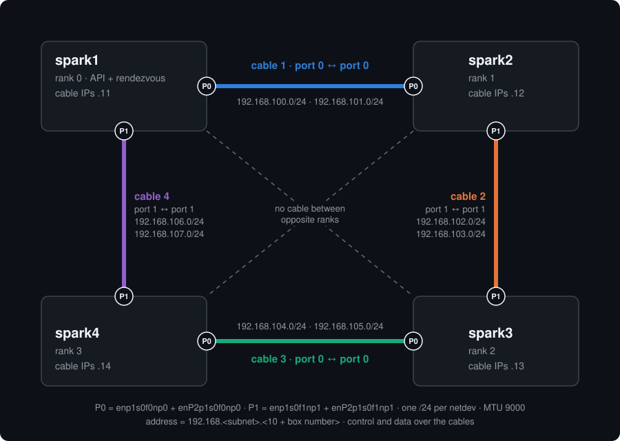

# Run GLM-5.3 on 4 DGX Sparks without a switch

**This is for you if** you have four DGX Spark or ASUS GX10 boxes, want to run the full GLM-5.3 (753B) across all
four, and don't have a 200G switch.

**What you need instead of a switch:** four QSFP cables, connecting the boxes in a ring.

**What you get:** a 512K context at about 40 tok/s, or the full 1M context at about 22 tok/s (measured, single runs).

**Have a switch?** Use the upstream [glm-5.3-tensorfold-tp4-4xgb10](https://github.com/bertholomus/glm-5.3-tensorfold-tp4-4xgb10)
recipe by BertholomusAI instead. This repo is that recipe adapted for the ring: cabling, IP plan, the switchless NCCL
build, a small engine patch, launch scripts and a preflight check.

Everything here was run on one site (3× DGX Spark + 1× ASUS GX10). Numbers are single runs, not a benchmark suite.
Host names (`spark1`…`spark4`) and the Tailscale address in the scripts are placeholders; the cable subnets are the
ones the site uses.

## What you need

- 4× GB10 (128 GB unified memory each), DGX OS / Ubuntu with Docker and the NVIDIA container runtime (stock on DGX OS).
  Mixed Spark / GX10 works.
- 4× QSFP direct-attach cables (the ones you would use Spark-to-Spark). Each box uses both of its 200G ports.
- A management network all four can reach each other on. This setup uses **Tailscale** (`tailscale0`) for rendezvous
  and NCCL's socket bootstrap; bulk data goes over the cables.
- A controller (laptop or one of the nodes) whose ssh key is authorized on all four, so `ssh spark1` etc. log in
  without a password, plus an ssh agent holding that key. The nodes don't need keys for each other: the copy step
  runs with your agent forwarded (`ssh -A`).
- Your user in the `docker` group on every node (`sudo usermod -aG docker $USER`, then log in again; it's the default
  on DGX OS).
- ~300 GB free on every node for the weights.
- The GPUs otherwise idle. Each rank sizes its cache from free memory at startup, so another model or container
  left running shrinks the window or makes the start fail.
- A firewall that allows the ranks to reach each other over Tailscale: TCP 29661 to rank 0 for rendezvous, plus
  NCCL's bootstrap sockets on `tailscale0` (random ports). If `ufw` is active, `sudo ufw allow in on tailscale0` on
  every node is the simple way. The cable interfaces carry RoCE (UDP 4791) and the copy step's ssh.

## 1. Cabling

Ranks go around the ring: rank r is cabled to rank r−1 and rank r+1. Opposite ranks (0↔2, 1↔3) have **no** link,
which is exactly what the stock recipe can't handle.



| Cable | From | To | Subnets (one per netdev half) |
|---|---|---|---|
| 1 | spark1 port 0 | spark2 port 0 | 192.168.100.0/24, 192.168.101.0/24 |
| 2 | spark2 port 1 | spark3 port 1 | 192.168.102.0/24, 192.168.103.0/24 |
| 3 | spark3 port 0 | spark4 port 0 | 192.168.104.0/24, 192.168.105.0/24 |
| 4 | spark4 port 1 | spark1 port 1 | 192.168.106.0/24, 192.168.107.0/24 |

"Port 0" is the port whose netdevs are `enp1s0f0np0` + `enP2p1s0f0np0`; "port 1" is `enp1s0f1np1` + `enP2p1s0f1np1`.
To find which physical cage is which, plug one cable and run `ip -br link`: the pair that turns `LOWER_UP` is that port.

## 2. IP addresses (netplan)

On a GB10 each 200G port appears as **two** netdevs (two PCIe halves) with their own RoCE device. Give every netdev its
own /24, and give every cable its own pair of /24s. **No subnet may appear on two cables.** With a duplicate, NCCL
picked the wrong NIC and failed with `ibv_modify_qp ... 110 Connection timed out`.

Host octet = 10 + box number (spark1 = .11 … spark4 = .14). Ready-made files are in [`netplan/`](netplan/):

```yaml
# netplan/61-ring-spark2.yaml  →  /etc/netplan/61-ring.yaml on spark2
network:
  version: 2
  ethernets:
    enp1s0f0np0:   {addresses: [192.168.100.12/24], mtu: 9000}   # port 0 -> spark1
    enP2p1s0f0np0: {addresses: [192.168.101.12/24], mtu: 9000}   # port 0 -> spark1
    enp1s0f1np1:   {addresses: [192.168.102.12/24], mtu: 9000}   # port 1 -> spark3
    enP2p1s0f1np1: {addresses: [192.168.103.12/24], mtu: 9000}   # port 1 -> spark3
```

On each node (needs sudo):

```bash
sudo install -m 600 61-ring-sparkN.yaml /etc/netplan/61-ring.yaml
sudo netplan apply
ip -br addr | grep -e enp1 -e enP2       # 4 addresses, all UP
```

No gateway and no DNS on these interfaces: each /24 has exactly two hosts, one at each end of the cable.

On DGX OS, `/etc/netplan/00-installer-config.yaml` sets `renderer: NetworkManager`, so these files show up as
`netplan-enp1s0f0np0` etc. in `nmcli con show`. That is expected. On a system without NetworkManager, netplan uses
systemd-networkd and the same files work. If a port also has an old NetworkManager profile with another address,
delete that profile so the port has only the address you set here.

### RoCE GID index 3

NCCL must use each port's **IPv4 RoCE v2** GID. On these boxes it is in slot **3** (the upstream recipe defaults to 5).
Check after any re-plug or reboot:

```bash
for d in rocep1s0f0 rocep1s0f1; do
  echo $d $(cat /sys/class/infiniband/$d/ports/1/gid_attrs/types/3) $(cat /sys/class/infiniband/$d/ports/1/gids/3)
done
# want: RoCE v2 0000:0000:0000:0000:0000:ffff:c0a8:....   (::ffff: + the IPv4 address)
```

If slot 3 is empty or IPv6, the address isn't up on that netdev yet; fix netplan first. If your boxes use another
slot, set `NCCL_IB_GID_INDEX` in `scripts/tfrun.sh`.

Only the `rocep1s0f0` and `rocep1s0f1` devices (one per port) are passed to NCCL (`HCA=` in `scripts/tp4_start.sh`).
The `enP2…` halves still need their own addresses so the subnets stay unique, but they carry no traffic here.

## 3. Software

The small parts (engine, this repo) are cloned on every node. The big parts (292.7 GB of weights, the 24 GB container
image, the NCCL build) are downloaded **once**, on rank 0, and copied to the other three over the 200G cables.

| Part | Version (pinned) |
|---|---|
| Upstream recipe | [`bertholomus/glm-5.3-tensorfold-tp4-4xgb10`](https://github.com/bertholomus/glm-5.3-tensorfold-tp4-4xgb10) @ `9a5c1100` (reference only) |
| Engine | [`bertholomus/TensorFold`](https://github.com/bertholomus/TensorFold/tree/glm-dsa-tp4) branch `glm-dsa-tp4` @ `ddfad356dc16f4d6bed9cfcc9d60cd0ebc0a3595` |
| Weights | [`bertholomus/GLM-5.3-EXL3-3.0bpw`](https://huggingface.co/bertholomus/GLM-5.3-EXL3-3.0bpw) @ `7f0573836c44803030912ffe5d051ca7587edfd6` (292.7 GB, 39 shards, not gated) |
| Container | `nvcr.io/nvidia/pytorch:26.07-py3` (image ID `sha256:15b8de8baabe…`, repo digest `sha256:7531d90bcbe0…`), public, no NGC login |
| NCCL | [`alexellis/switchless-nccl`](https://github.com/alexellis/switchless-nccl) v0.0.1, `nccl-2.30.7-switchless-hardened-sm121-linux-arm64` |
| Hugging Face CLI | `huggingface_hub==0.34.4` (rank 0 only, for the download) |

### 3a. Engine, ring patch and scripts (every node)

```bash
mkdir -p ~/glm53-tf && cd ~/glm53-tf
git clone https://github.com/mindesh/glm-5.3-tensorfold-tp4-4xgb10-ring ring
git clone -b glm-dsa-tp4 https://github.com/bertholomus/TensorFold
git -C TensorFold checkout ddfad356dc16f4d6bed9cfcc9d60cd0ebc0a3595
git -C TensorFold apply ../ring/patches/tensorfold-dcp-ring.patch   # needed for 1M only; harmless otherwise
cp ring/scripts/tfrun.sh . && chmod +x tfrun.sh
```

### 3b. Big downloads (rank 0 only)

```bash
# Hugging Face CLI in its own venv (Ubuntu 24.04 blocks system-wide pip installs)
python3 -m venv ~/hf-cli && ~/hf-cli/bin/pip install -q huggingface_hub==0.34.4
~/hf-cli/bin/hf download bertholomus/GLM-5.3-EXL3-3.0bpw --revision 7f0573836c44803030912ffe5d051ca7587edfd6 \
  --local-dir ~/models/GLM-5.3-EXL3-3.0bpw

docker pull nvcr.io/nvidia/pytorch:26.07-py3

# switchless NCCL: a patched NCCL 2.30.7 that only talks to directly cabled peers, with subnet-aware NIC choice
mkdir -p ~/switchless-nccl && cd ~/switchless-nccl
U=https://github.com/alexellis/switchless-nccl/releases/download/v0.0.1/nccl-2.30.7-switchless-hardened-sm121-linux-arm64.tar.gz
curl -LO $U
echo "b4a686382a92e57b485ca1bf7cd0f9fde780a68f01ea902ac432b60505b2041f  ${U##*/}" | sha256sum -c
tar -xzf ${U##*/}
ls nccl-2.30.7-switchless-hardened-sm121-linux-arm64/libnccl.so.2      # must exist
```

If the download is interrupted, run the same `hf download` again; it resumes.

### 3c. Copy to the other ranks over the cables

From the controller, log in to rank 0 with your agent forwarded and run [`scripts/distribute.sh`](scripts/distribute.sh):

```bash
ssh -A spark1
~/glm53-tf/ring/scripts/distribute.sh --dry     # prints the copy commands; check the addresses
~/glm53-tf/ring/scripts/distribute.sh           # copies, then compares all four nodes
```

It copies to rank 1 (cable 1) and rank 3 (cable 4), then from rank 1 on to rank 2 (cable 2). Finally it checks that
every node has the same image ID, the same NCCL library hash, and the same weight file count and total size, and
prints `ALL COPIES MATCH`. `--check` runs only that comparison. The cable addresses of ranks 1–3 are at the top of
the script (`R1`, `R3`, `R2`); change them there if your IP plan differs. The first connection to each cable address
accepts that host's ssh key automatically.

If you keep the NCCL build somewhere else, set `NCCL_SWITCHLESS_DIR` on that node, or edit the default in
`scripts/tfrun.sh`.

## 4. Configure and check

On the controller, clone this repo too and edit the top of [`scripts/tp4_start.sh`](scripts/tp4_start.sh):

- `NODES`: ssh names **in ring order** (rank 0 first, then around the ring).
- `MASTER`: rank 0's Tailscale IP (`tailscale ip -4` on rank 0).
- `HCA`: check names with `ibv_devinfo`. They were `rocep1s0f0,rocep1s0f1` on all four of our boxes.

Then run the read-only preflight:

```bash
bash scripts/ring_check.sh
```

It checks, on every node:

- the cable ports are up at MTU 9000;
- GID 3 is an IPv4 RoCE v2 GID;
- your user can run `docker`;
- the switchless NCCL, weights, image, TensorFold commit, ring patch and ring `tfrun.sh` are present.

Across nodes, it checks that every /24 sits on exactly two ports on neighbouring ranks, and that a 9000-byte
no-fragment ping goes across every cable. Fix anything marked `FAIL` before starting.

## 5. Start

All commands run from the controller. `tp4_start.sh` starts the four ranks, then waits until rank 0 answers on
`/v1/models` and prints `ready after N s`. Loading took 182–260 s in our runs. If a rank's container exits during
loading, the script stops and tells you which rank's logs to read. It gives up after 900 s.

**512K, one stream (fastest single stream):**

```bash
TF_GLM_KV=q5 TF_GLM_EMBED_SPLIT=1 TF_GLM_MTP_REUSE=2 \
  bash scripts/tp4_start.sh 524288 "--mtp-drafts 3 --parallel 1"
```

**~500K shared by 2 streams** (e.g. an agent with 400K plus a chat with 100K). With `--parallel 2`, 524288 is refused.
The engine's estimated maximum is 505,595 tokens, so we use 503808 (2048-aligned):

```bash
TF_GLM_KV=q5 TF_GLM_EMBED_SPLIT=1 TF_GLM_MTP_REUSE=2 TF_GLM_EXTENTS=1 \
  bash scripts/tp4_start.sh 503808 "--mtp-drafts 3 --parallel 2"
```

**1M, context parallel over 4 ranks** (needs the patch):

```bash
TF_GLM_KV=q5 TF_GLM_EMBED_SPLIT=1 TF_GLM_DCP=4 TF_GLM_MTP_REUSE=2 TF_GLM_EXTENTS=1 \
  bash scripts/tp4_start.sh 1048576 "--mtp-drafts 3 --parallel 4"
```

`tp4_start.sh` always adds the two required ring settings, `TF_GLM_RDMA=0` and `TF_GLM_PROMPT_REDUCE=gather` (see
below), and `--no-update-check`.

Then test:

```bash
ssh spark1 'curl -s 127.0.0.1:18090/v1/chat/completions -H "Content-Type: application/json" \
  -d "{\"model\":\"GLM-5.3-EXL3-3.0bpw\",\"messages\":[{\"role\":\"user\",\"content\":\"What is 7+5?\"}],\"max_tokens\":200}"'
```

The server listens on **127.0.0.1:18090 with no authentication**. To reach it from other machines, put something with
access control in front of it. We use `tailscale serve`, which is tailnet-only:
`sudo tailscale serve --bg --https=443 http://127.0.0.1:18090`. This needs HTTPS certificates turned on for your
tailnet first (Tailscale admin console → DNS → HTTPS Certificates). Never bind the server to 0.0.0.0, and never
port-forward it.

Stop it with `bash scripts/tp4_stop.sh`. The containers have no restart policy, so nothing comes back on its own
after a reboot. The next `tp4_start.sh` also stops any old ranks first.

## What breaks on a ring, and the fix

| Symptom | Cause | Fix (where) |
|---|---|---|
| `ibv_modify_qp failed with 110 Connection timed out`; the remote GID is on a subnet the local port isn't cabled to | Stock NCCL tries to reach every rank directly | Switchless NCCL plus its ring settings (`tfrun.sh`) |
| `NCCL error 2: unhandled system error` in `comm.barrier()` | Same as above | Same as above |
| Same 110 timeout with switchless NCCL | Two cables share a subnet, so the wrong NIC is picked | A unique /24 per netdev and per cable (netplan) |
| Nothing connects; the GID is IPv6 or missing | Wrong GID slot | `NCCL_IB_GID_INDEX=3` (`tfrun.sh`), and check it after a reboot |
| `NCCL error 2` in `forward.py … reduce → comm.grouped` during warm-up | The prompt-chunk reduce does grouped send/recv to every peer | `TF_GLM_PROMPT_REDUCE=gather` (`tp4_start.sh`) |
| Engine RDMA gather can't reach the opposite rank | It writes to every peer | `TF_GLM_RDMA=0` (`tp4_start.sh`); `NCCL_NET_PLUGIN=spcx` removed |
| `NCCL error 2` in `dcp.py attention → comm.grouped` (only with `TF_GLM_DCP=4`) | The DCP prompt exchange sends each group straight to its owner | `patches/tensorfold-dcp-ring.patch` |

The `dcp.py` patch: prompt chunks used grouped send/recv to every peer, while decode windows already used an
all-gather. The patch makes prompt chunks all-gather too, in row slices sized to fit the existing receive buffer, so
it uses no extra memory. It sends more bytes but produces the same bits. A long-prompt needle test passed with it
(below).

All differences from the upstream scripts:

- `tfrun.sh`:
  - switchless NCCL is mounted, preloaded, and set as `TF_NCCL_LIB`;
  - `TF_NCCL_GATHER=ring`;
  - the `NCCL_*` ring settings;
  - GID index 3;
  - no `--rm`, so a crashed rank keeps its logs.
- `tp4_start.sh`:
  - nodes in ring order;
  - master and socket interface on Tailscale;
  - one HCA per cabled port;
  - no `spcx`;
  - `TF_GLM_RDMA=0` and `TF_GLM_PROMPT_REDUCE=gather`;
  - `--no-update-check`;
  - waits until rank 0 is ready.

## Measured

All single runs with synthetic prompts and greedy decoding.

| | 512K, 1 stream | ~500K, 2 streams | 1M, DCP4 + patch |
|---|---|---|---|
| Startup estimate per rank | 102.55 GiB | n/a | 96.27 GiB |
| Load time | 192–260 s | 211 s | 182 s |
| Reply speed, 1 stream | 39.3–39.9 tok/s | 29.9–31.2 tok/s | 22.4 tok/s |
| Reply speed, 2 streams at once (total) | n/a | 38.6–42.3 tok/s | not run |
| 9K-token prompt with a planted fact, total time | 21 s | n/a | 43 s |
| 123K-token prompt with a planted fact, total time | not run | n/a | 552 s (~223 tok/s prefill) |
| Planted fact found | yes | n/a | yes (9K and 123K) |
| GPU temperature in these tests | 51–54 °C | 66–74 °C (long eval) | 60–67 °C |

In the 2-stream setup, two concurrent requests returned the same answers as solo runs. That setup also scored 10/10
on a private 10-task reasoning and code-review set, taking 38.8 min in total.

For comparison, the recipe author reports these numbers with a switch for the 1M setup: 33–39 tok/s on a single
stream, and about 400 tok/s prefill at 32K. On the ring, the 1M setup loses the most, because every decode step's
all-gather travels around the ring instead of using direct RDMA writes.

## Not tested

- Prompts above 123K (no 500K or 1M needle run).
- More than one concurrent stream on the 1M setup.
- Tool calling and streaming through this setup.
- Long-run stability (days).
- Any rendezvous network other than Tailscale.
- `distribute.sh` copying onto empty nodes. Our nodes were filled by hand; the script's `--dry` and
  `--check` modes were run against them, and `--check` found all four identical.

## Takeaways

- Use **512K without DCP** for speed. Use the **2-stream** setup when an agent and a chat share the cluster. Use
  **1M with DCP plus the patch** only when you need the window.
- What actually matters: the switchless NCCL build, a unique subnet on every cable, the right GID slot, and keeping
  every collective an all-gather or a ring.

## Credits and license

- [BertholomusAI](https://github.com/bertholomus): the GLM-5.3 TP4 recipe, the `glm-dsa-tp4` engine branch and the
  EXL3 quant. `scripts/tfrun.sh` and `scripts/tp4_start.sh` are modified copies of the recipe's scripts.
- [ashhart/TensorFold](https://github.com/ashhart/TensorFold): the engine.
- [alexellis/switchless-nccl](https://github.com/alexellis/switchless-nccl): the switchless NCCL build.
- Z.AI: GLM-5.3. The weights stay under the GLM-5.3 License.
- NVIDIA: the PyTorch container and NCCL.

This repository's scripts, patch and docs are Apache-2.0 (see `LICENSE`), the same license as the upstream recipe
and TensorFold. Not affiliated with or endorsed by any of the above.
